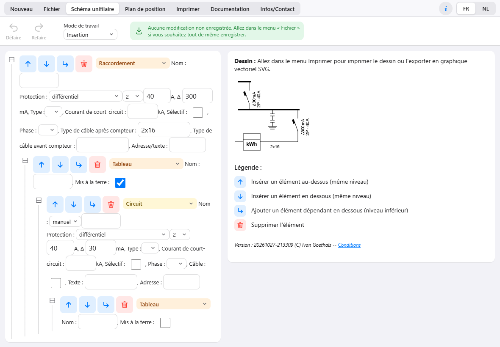
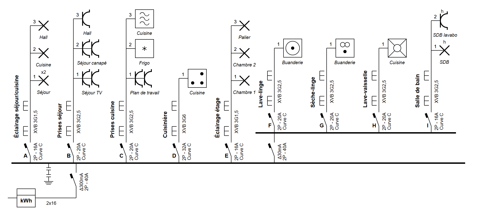
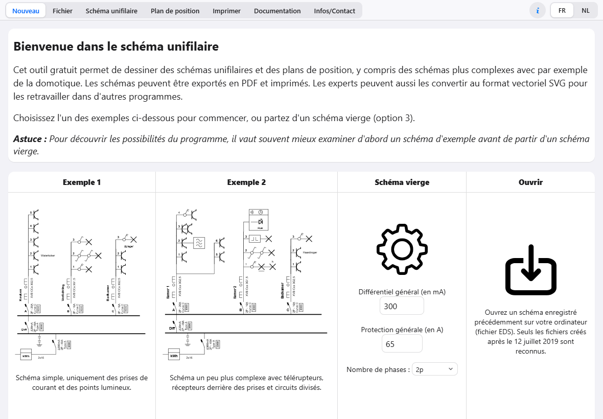
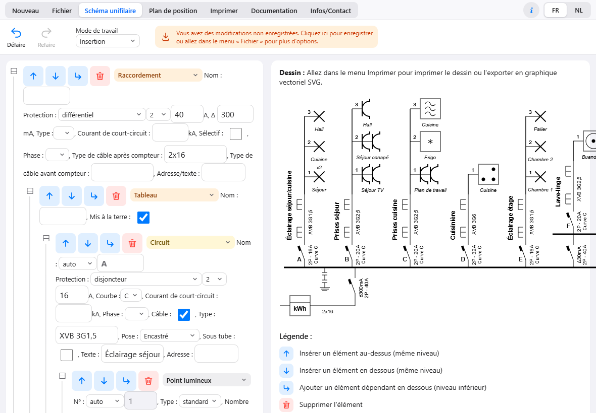

# Tutoriel UniSchema sur iPad : installer l'app et dessiner une maison

Durée : 5 minutes pour l'installation, 20 à 30 minutes pour la maison.

---

## Partie 1 — Installer UniSchema sur l'iPad (icône sur l'écran d'accueil)

1. Ouvrir **Safari** (pas Chrome : sur iPad, seul Safari peut installer l'app).
2. Aller à **https://bolz002.github.io/schema-unifilaire/**
3. Toucher **Partager** (carré avec une flèche vers le haut, en haut à droite).
4. Faire défiler et toucher **Sur l'écran d'accueil**.
5. Vérifier le nom **UniSchema**, puis **Ajouter**.
6. Toucher la nouvelle **icône éclair** : l'app s'ouvre en plein écran.
7. La laisser ouverte quelques secondes avec internet : elle se met en cache.

Test : mode Avion, fermer l'app (balayer vers le haut), la rouvrir. Elle doit s'ouvrir avec le badge « Hors ligne ».

> Si « Sur l'écran d'accueil » n'apparaît pas, l'iPad est probablement géré par l'entreprise (MDM) : voir le service informatique.

---

## Partie 2 — Comprendre l'écran

| Zone | Rôle |
|---|---|
| **Onglets** en haut | Nouveau · Fichier · Schéma unifilaire · Plan de position · Imprimer · Documentation |
| **i** et **FR / NL** | À propos de l'app · langue |
| **Barre d'outils** | Défaire / Refaire · mode de travail · état de l'enregistrement |
| **Colonne de gauche** | L'arborescence : chaque ligne est un élément (raccordement, tableau, circuit, point…) avec ses propriétés |
| **Colonne de droite** | Le **dessin** du schéma, mis à jour à chaque modification |

Les quatre boutons de chaque élément :

| Bouton | Action |
|---|---|
| **↑** | insérer un élément **au-dessus**, au même niveau |
| **↓** | insérer un élément **en dessous**, au même niveau (le plus utilisé) |
| **↳** | ajouter un élément **dépendant**, un niveau plus bas (ex. le premier circuit d'un tableau, le premier point d'un circuit) |
| **Poubelle** | supprimer l'élément et tout ce qui en dépend |

Le carré **⊟ / ⊞** à gauche d'une ligne replie ou déplie ses éléments dépendants.
Au doigt : **appui long** = menu contextuel ; **deux doigts** = zoom sur le plan de position.

---

## Partie 3 — Dessiner une maison pas à pas

La maison exemple : un raccordement 2 × 40 A, un différentiel général 300 mA, cinq circuits « secs » et quatre circuits « humides » derrière un différentiel 30 mA.

> Les calibres et sections ci-dessous sont un **exemple courant**. Dimensionner chaque installation selon le RGIE et la faire contrôler par un organisme agréé.

### Étape 1 — Partir d'un schéma vierge

1. Onglet **Nouveau**.
2. Colonne **Schéma vierge** : Différentiel général **300** mA, Protection générale **40** A, Nombre de phases **2p**.
3. **Continuer avec cette option**.

L'app crée la base d'une installation domestique :

- **Raccordement** (compteur, différentiel général 300 mA, câble 2x16) ;
- **Tableau** principal ;
- un **Circuit** avec différentiel **30 mA** (pour les pièces humides) ;
- un second **Tableau** derrière ce 30 mA.

### Étape 2 — Le premier circuit : éclairage du séjour

1. Sur la ligne **Tableau** (le premier), toucher **↳**. Une ligne vide apparaît dessous.
2. Dans sa liste de type, choisir **Circuit**.
3. Remplir :
   - Protection : **disjoncteur**, **2** pôles, **16** A, Courbe **C** ;
   - cocher **Câble**, Type **XVB 3G1,5**, Pose **Encastré** ;
   - Texte : **Éclairage séjour/cuisine** (il apparaît au-dessus du circuit sur le dessin).
4. Le circuit reçoit automatiquement la lettre **A**.

### Étape 3 — Les points du circuit

1. Sur la ligne du **circuit A**, toucher **↳** → choisir **Point lumineux** → Nombre **2**, Adresse/texte **Séjour**.
2. Sur ce point, toucher **↓** → **Point lumineux** → Adresse **Cuisine**.
3. Encore **↓** → **Point lumineux** → Adresse **Hall**.

Les points sont numérotés 1, 2, 3 automatiquement, comme sur le dessin.

### Étape 4 — Les autres circuits du tableau principal

Sur la ligne d'un circuit, **↓** ajoute le circuit suivant au même niveau. Pour chacun : type **Circuit**, protection **disjoncteur**, puis ses points avec **↳** (le premier) et **↓** (les suivants).

| Circuit | Protection | Câble | Points |
|---|---|---|---|
| B — Prises séjour | 20 A, courbe C | XVB 3G2,5 | Prise de courant ×2 (Séjour TV), ×2 (Séjour canapé), Prise (Hall) |
| C — Prises cuisine | 20 A, courbe C | XVB 3G2,5 | Prise ×2 (Plan de travail), Réfrigérateur, Four à micro-ondes |
| D — Cuisinière | 32 A, courbe C | XVB 3G6 | Cuisinière |
| E — Éclairage étage | 16 A, courbe C | XVB 3G1,5 | Points lumineux Chambre 1, Chambre 2, Palier |

Pour une prise double, choisir **Prise de courant** et Nombre **2**. Les options utiles : **Mis à la terre**, **Sécurité enfants**, **Semi-étanche**.

### Étape 5 — Les circuits des pièces humides (derrière le 30 mA)

Sur le **second Tableau** (celui sous le circuit différentiel 30 mA), toucher **↳** pour le premier circuit, puis **↓** pour les suivants :

| Circuit | Protection | Câble | Point |
|---|---|---|---|
| F — Lave-linge | 20 A, courbe C | XVB 3G2,5 | Lave-linge (Buanderie) |
| G — Sèche-linge | 20 A, courbe C | XVB 3G2,5 | Sèche-linge (Buanderie) |
| H — Lave-vaisselle | 20 A, courbe C | XVB 3G2,5 | Lave-vaisselle (Cuisine) |
| I — Salle de bain | 16 A, courbe C | XVB 3G2,5 | Point lumineux **semi-étanche**, Prise **semi-étanche** |

### Étape 6 — Les informations du cartouche

Tout en bas de la colonne de gauche : **Lieu de l'installation électrique**, **Installateur**, **Organisme agréé**, **Info**. Toucher un cadre pour le remplir : ces textes apparaissent dans le cartouche du PDF.

### Étape 7 — Enregistrer

- UniSchema **enregistre automatiquement** sur l'iPad (le travail est retrouvé à la réouverture).
- Pour garder un fichier : onglet **Fichier** → **Enregistrer** → un fichier **.eds** est proposé ; le placer dans **Fichiers** (iCloud Drive, OneDrive…). C'est la vraie sauvegarde : à faire régulièrement.
- Pour rouvrir : **Nouveau** → **Ouvrir** → choisir le `.eds`.

### Étape 8 — Imprimer en PDF

Onglet **Imprimer** → format **A4** → **Générer le PDF**. Le PDF contient le schéma et le cartouche ; l'envoyer ou l'enregistrer depuis le menu Partager de l'iPad.

### Étape 9 (facultatif) — Le plan de position

1. Onglet **Plan de position**.
2. **Depuis un fichier** : charger le plan de la maison (photo ou PDF converti en image).
3. **Depuis le schéma** : choisir un élément (ex. A.1 Point lumineux) et le placer sur le plan.
4. Au doigt : glisser pour déplacer, **appui long** pour pivoter / modifier, **deux doigts** pour zoomer.

---

## Astuces

- **Défaire** (en haut à gauche) annule la dernière action, sans limite pratique.
- Mode de travail **Déplacer/Cloner** : des flèches pour changer l'ordre, **Cloner** pour dupliquer un circuit entier avec ses points.
- Les lettres des circuits (A, B, C…) et les numéros des points sont automatiques ; on peut les imposer en passant Nom ou N° sur **manuel**.
- Un élément mal placé : le **supprimer** (poubelle) et le recréer au bon endroit, ou le déplacer en mode Déplacer/Cloner (champ **Parent**).

## Ouvrir directement la maison exemple

Le fichier de ce tutoriel est fourni : [`examples/exemple_maison.eds`](../examples/exemple_maison.eds). Le télécharger sur l'iPad (bouton de téléchargement de GitHub, vers Fichiers), puis dans UniSchema : **Nouveau** → **Ouvrir** → choisir le fichier.
